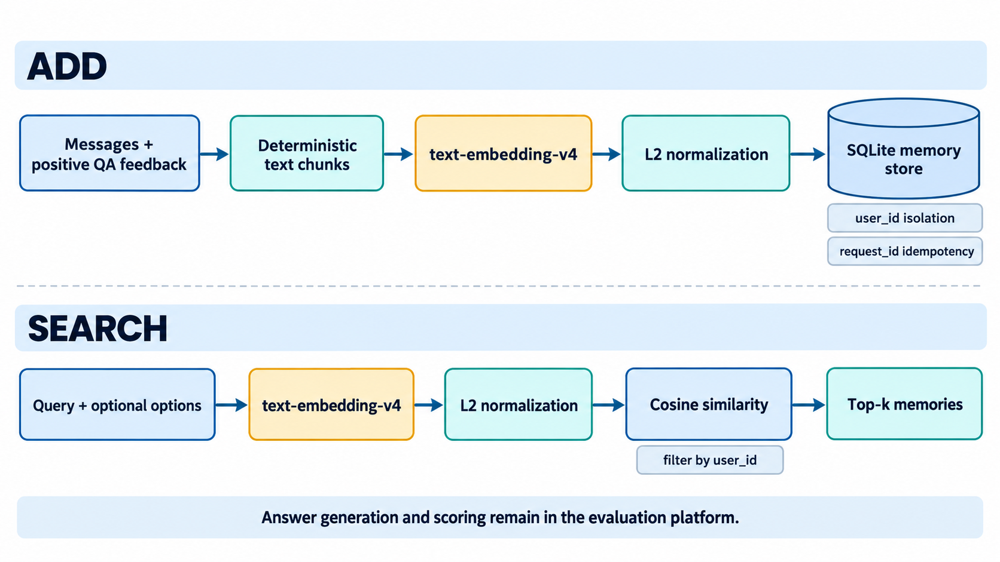

# StreamICL-inspired Text Memory API

This repository provides a text-only Add/Search memory service for Agent Memory Leaderboard. It is inspired by StreamICL, but it is not a reproduction of Self-StreamICL. The evaluation platform owns answer generation and scoring; this service only stores and retrieves memory.

## Method



- Add divides text into deterministic chunks of at most 8,000 characters. Positive-score Streaming QA feedback is stored as a question-answer example; nonpositive feedback is acknowledged but not indexed.
- Every chunk is embedded through an OpenAI-compatible embeddings endpoint with the fixed model `text-embedding-v4`. Returned vectors are L2-normalized before storage and ranking.
- SQLite stores text, normalized vectors, and Add request IDs. Memories are isolated by exact `user_id`.
- Search embeds the question and any top-level multiple-choice `options`, ranks the user's memories by cosine similarity, and returns at most the requested `top_k`.
- Add is synchronous: HTTP 200 is returned only after embeddings and SQLite writes complete. Repeating an identical `request_id` is idempotent; reusing one for a different payload returns HTTP 409.

The StreamBench Self-StreamICL reference is a complete answering agent: it indexes only correct self-generated answers by question, retrieves them with BGE and FAISS, and inserts the retrieved examples into the next answer prompt. This service instead exposes the leaderboard Add/Search boundary, persists source-message chunks and positive-feedback examples, and leaves prompt construction and answer generation to the evaluation platform. It does not call an LLM, so no LLM model is configured here; its embedding component uses `text-embedding-v4`.

## Configuration

Copy `.env.example` to `.env.local` and set these values:

```dotenv
PARTICIPANT_MEMORY_API_KEY=replace-with-a-random-secret-of-at-least-32-characters
OPENAI_EMBEDDING_API_BASE=https://dashscope.aliyuncs.com/compatible-mode/v1
OPENAI_EMBEDDING_API_KEY=replace-with-your-embedding-api-key
PARTICIPANT_MEMORY_DATABASE=participant_text_memory/data/text_embedding_v4_memory.db
```

`OPENAI_EMBEDDING_API_BASE` must be the OpenAI-compatible API root that contains `/embeddings`; do not append `/embeddings` itself. Keep both API keys private. Use a new SQLite database whenever the embedding model changes because vectors from different models cannot be mixed.

## Run locally

Requires Python 3.10 or newer. From the repository root in PowerShell:

```powershell
python -m venv .venv
.\.venv\Scripts\python -m pip install -r requirements.txt
Copy-Item .env.example .env.local
.\.venv\Scripts\python -c "import secrets; print(secrets.token_hex(32))"
```

Put the generated secret and the embedding API credentials in `.env.local`, then run:

```powershell
.\start.ps1
```

The service listens on `http://127.0.0.1:8094`. The startup script does not create a public tunnel.

## Deploy on Ubuntu 22.04

The following commands assume the `ubuntu` user and `/home/ubuntu/StreamICL`. The application listens only on localhost; Caddy provides public HTTPS.

```bash
sudo apt update
sudo apt install -y git python3-venv python3-pip curl
git clone https://github.com/solomoon313/StreamICL.git
cd StreamICL
python3 -m venv .venv
.venv/bin/pip install --upgrade pip
.venv/bin/pip install -r requirements.txt
cp .env.example .env.local
.venv/bin/python -c 'import secrets; print(secrets.token_hex(32))'
nano .env.local
chmod 600 .env.local
```

Set `PARTICIPANT_MEMORY_API_KEY`, `OPENAI_EMBEDDING_API_BASE`, and `OPENAI_EMBEDDING_API_KEY` in `.env.local`. Keep `PARTICIPANT_MEMORY_DATABASE` on the new `text_embedding_v4_memory.db` path.

Install and start the persistent service:

```bash
sudo cp deploy/streamicl.service /etc/systemd/system/streamicl.service
sudo systemctl daemon-reload
sudo systemctl enable --now streamicl
sudo systemctl status streamicl --no-pager
curl http://127.0.0.1:8094/health
```

On failure, inspect `sudo journalctl -u streamicl -n 80 --no-pager`.

In Cloudflare DNS, create an `A` record named `memory` pointing to the server public IPv4, with proxy status **DNS only**. In the Tencent Cloud instance firewall, allow inbound TCP 80 and 443. Do not open port 8094 publicly. Install Caddy using its [official Ubuntu instructions](https://caddyserver.com/docs/install), then:

```bash
sudo cp deploy/Caddyfile /etc/caddy/Caddyfile
sudo caddy validate --config /etc/caddy/Caddyfile
sudo systemctl reload caddy
curl https://memory.848496.xyz/health
```

Caddy obtains and renews the HTTPS certificate automatically once DNS and ports 80/443 work.

## API

`GET /health` requires no authentication. Add and Search require `Authorization: Bearer <PARTICIPANT_MEMORY_API_KEY>`; `Authorization: Token` and `X-API-Key` are also accepted.

```text
POST /v1/memories/add
POST /v1/memories/search
```

Add requires `request_id`, `messages` (`role`, nonempty string `content`, optional Unix-millisecond `timestamp`), `user_id`, and `session_id`. Search requires `query`, `user_id`, and `top_k`; `options` is an optional top-level string array for multiple-choice questions. Search returns `{"data": [...]}` in relevance order, or `{"data": []}`. Only text content is supported.

## Test and data retention

```powershell
.\.venv\Scripts\python -m pip install pytest
.\.venv\Scripts\python -m pytest tests -q
```

The SQLite database is ignored by Git. Add text and Search queries are sent to the configured embedding provider, so that provider and its logging policy must satisfy the evaluation's privacy requirements. Do not log or publish evaluation payloads or keys. Delete evaluation data within 30 days after a run unless the platform grants written permission to retain it longer.

## Attribution

The StreamICL idea comes from Cheng-Kuang Wu, Zhi Rui Tam, Chieh-Yen Lin, Yun-Nung Chen, and Hung-yi Lee, [*StreamBench: Towards Benchmarking Continuous Improvement of Language Agents*](https://papers.nips.cc/paper_files/paper/2024/hash/c189915371c4474fe9789be3728113fc-Abstract-Datasets_and_Benchmarks_Track.html), with [source code](https://github.com/stream-bench/stream-bench). This service also draws on the [AgentMemoryBench streamICL baseline](https://github.com/solomoon313/AgentMemoryBench). The API service here was written separately and differs in the ways listed above.
